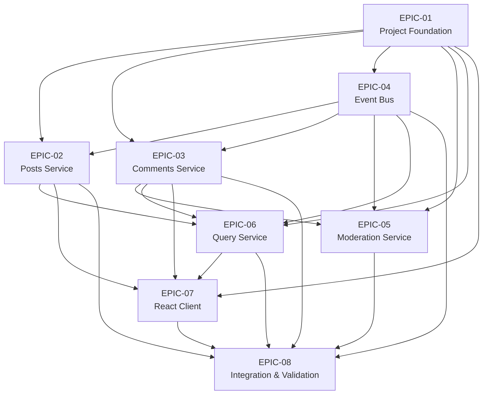

# Agentic Blog — Epic Catalog

**Status:** Proposed — pending review  
**SDLC Phase:** Task Decomposition & Agent Orchestration  
**Parent document:** `docs/implementation/implementation-breakdown.md`  
**Architecture reference:** `docs/architecture/target-architecture.md`  
**Requirements reference:** `docs/requirements/`

---

# 1. Purpose

This document defines the Epics that organize the implementation of the Agentic Blog application.

Each Epic represents a significant implementation area and groups related Stories into manageable outcomes.

The purpose is to translate the approved architecture, product requirements and implementation plan into work that can later be managed through Jira.

This is initially a Markdown-based backlog. Jira will become the work management source of truth once access is available.

## 1.1 Implementation principles

The implementation must follow these principles:

- Reproduce the existing application's capabilities and architecture as the initial baseline.
- Preserve the existing service boundaries and communication patterns.
- Avoid introducing new technologies or architectural improvements without an explicit decision.
- Implement in small, independently verifiable increments.
- Maintain traceability between requirements, Stories, implementation and validation.
- Use AI to assist with analysis, implementation, documentation and testing.
- Keep architecture decisions, scope approval and final validation under human responsibility.

## 1.2 Epic hierarchy

| ID | Epic | Main outcome |
|---|---|---|
| EPIC-01 | Project Foundation | Development environment and project structure |
| EPIC-02 | Posts Service | Post creation and retrieval |
| EPIC-03 | Comments Service | Comment creation, retrieval and moderation state |
| EPIC-04 | Event Bus | Event storage and distribution |
| EPIC-05 | Moderation Service | Automatic comment moderation |
| EPIC-06 | Query Service | Read model and event projection |
| EPIC-07 | React Client | User-facing blog interface |
| EPIC-08 | Integration & Validation | End-to-end application validation |

---

# 2. EPIC-01 — Project Foundation

**Objective:** Establish the technical foundation required to implement and run the application.

### Scope

- Confirm the existing technology stack and runtime assumptions.
- Establish the application directory structure.
- Initialize frontend and backend project configurations.
- Define local development configuration.
- Establish basic development and validation commands.

### Stories

**STORY-01 — Confirm Technology Stack**

Inspect and document the frontend, backend, dependencies, runtime and package management requirements.

**STORY-02 — Establish Application Structure**

Define and initialize the new project's directory and package structure while preserving the agreed service boundaries.

**STORY-03 — Configure Local Development Environment**

Define local service ports, configuration conventions, environment variables and development commands.

**STORY-04 — Establish Development and Validation Foundations**

Define code organization conventions, initial testing approach and basic build and validation commands.

### Dependencies

- Existing application discovery.
- Architecture overview.
- Target architecture.
- Project instructions in `AGENTS.md`.

### Acceptance criteria

- Technology stack and runtime assumptions are documented.
- Application directory structure is established.
- Frontend and backend project configurations are initialized.
- Local service configuration is documented.
- Basic development and validation commands are available.

### AI and human responsibilities

AI assists with source inspection, configuration generation and validation. The human approves the technology choices, project structure and any deviations from the existing baseline.

### Out of scope

Business logic, database implementation, durable messaging, CI/CD and architectural redesign.

---

# 3. EPIC-02 — Posts Service

**Objective:** Implement the service responsible for creating and retrieving blog posts.

### Scope

- Establish the Posts Service.
- Implement its in-memory post representation.
- Implement post creation.
- Implement post retrieval.
- Publish post creation events through the Event Bus.

### Stories

**STORY-01 — Establish Posts Service**

Create the service configuration, application entry point and required dependencies.

**STORY-02 — Implement Post Storage and Representation**

Reproduce the existing in-memory post model and storage behavior.

**STORY-03 — Implement Post Creation API**

Implement the existing post creation endpoint:

`POST /posts/create`

Preserve the original request and response contract after inspecting the legacy implementation.

**STORY-04 — Implement Post Retrieval API**

Implement the existing post retrieval endpoint:

`GET /posts`

Preserve the original behavior and response structure.

**STORY-05 — Integrate Post Creation with Event Bus**

Publish the `PostCreated` event when a post is created, following the existing event flow.

### Dependencies

- EPIC-01 — Project Foundation.
- EPIC-04 — Event Bus for event publication integration.

The core API and storage work can begin before Event Bus integration is available.

### Acceptance criteria

- Posts Service starts using the agreed local configuration.
- Posts can be created through the existing API.
- Posts can be retrieved through the existing API.
- Post data follows the existing model and behavior.
- Creating a post publishes the expected `PostCreated` event once Event Bus integration is complete.
- Relevant API behavior is validated.

### AI and human responsibilities

AI assists with analyzing the legacy implementation, generating service code, tests and API documentation. The human validates the existing API contract, business behavior and implementation consistency.

### Out of scope

Persistent database, post editing, post deletion, authentication and new post-management capabilities.

---

# 4. EPIC-03 — Comments Service

**Objective:** Implement the service responsible for creating, retrieving and maintaining comments associated with posts.

### Scope

- Establish the Comments Service.
- Implement the in-memory comment representation.
- Implement comment creation.
- Implement comment retrieval.
- Handle moderation results.
- Publish comment lifecycle events.

### Stories

**STORY-01 — Establish Comments Service**

Create the service configuration, application entry point and required dependencies.

**STORY-02 — Implement Comment Storage and Representation**

Reproduce the existing comment model and in-memory storage behavior.

**STORY-03 — Implement Comment Creation API**

Implement the existing endpoint:

`POST /posts/:id/comments`

Preserve the original request and response contract.

**STORY-04 — Implement Comment Retrieval API**

Implement the existing endpoint:

`GET /posts/:id/comments`

Preserve the existing retrieval behavior.

**STORY-05 — Implement Comment Moderation Result Handling**

Handle `CommentModerated` events and update the corresponding comment's moderation status.

**STORY-06 — Publish Comment Lifecycle Events**

Publish the existing events:

- `CommentCreated`
- `CommentUpdated`

Preserve the original event structure and lifecycle.

### Dependencies

- EPIC-01 — Project Foundation.
- EPIC-04 — Event Bus.
- EPIC-05 — Moderation Service for complete moderation integration.

Core comment creation and retrieval can be developed before the full moderation flow is available.

### Acceptance criteria

- Comments Service starts using the agreed local configuration.
- Comments can be created for a post.
- Comments can be retrieved by post ID.
- Newly created comments follow the existing pending-state behavior.
- Moderation results update the corresponding comment.
- Comment lifecycle events are published and handled correctly.
- Relevant API and event behavior is validated.

### AI and human responsibilities

AI assists with code analysis, implementation, event handling and tests. The human validates comment lifecycle behavior, event contracts and moderation-state transitions.

### Out of scope

User accounts, comment editing, comment deletion, manual moderation tools and persistent storage.

---

# 5. EPIC-04 — Event Bus

**Objective:** Implement the event distribution service responsible for storing events and forwarding them to subscribed services.

### Scope

- Establish the Event Bus service.
- Implement in-memory event storage.
- Implement event publication.
- Implement event retrieval.
- Implement subscriber notification.
- Preserve the existing event distribution behavior.

### Stories

**STORY-01 — Establish Event Bus Service**

Create the service configuration, application entry point and required dependencies.

**STORY-02 — Implement Event Storage**

Reproduce the existing in-memory event collection and event representation.

**STORY-03 — Implement Event Publication API**

Implement the existing event publication endpoint:

`POST /events`

Store incoming events and initiate notification of the configured subscribers.

**STORY-04 — Implement Event Retrieval API**

Implement the existing endpoint:

`GET /events`

Return the stored event history using the existing response contract.

**STORY-05 — Implement Subscriber Notification**

Forward published events to the existing subscribers:

- Posts Service
- Comments Service
- Query Service
- Moderation Service

Preserve the existing notification behavior and service responsibilities.

### Dependencies

- EPIC-01 — Project Foundation.
- The service can be implemented independently, but integration requires the relevant service endpoints to be available.

### Acceptance criteria

- Event Bus starts using the agreed local configuration.
- Events can be published.
- Published events are stored in memory.
- Events can be retrieved through the existing API.
- Events are forwarded to the configured subscribers.
- Event structures and subscriber behavior are consistent with the existing application.

### AI and human responsibilities

AI assists with identifying event contracts, implementing distribution logic and generating integration tests. The human validates event semantics, subscriber responsibilities and behavior against the legacy application.

### Out of scope

Durable messaging, message brokers, guaranteed delivery, retries, dead-letter queues and architectural changes to event processing.

These are potential future improvements, not part of the baseline reproduction.

---

# 6. EPIC-05 — Moderation Service

**Objective:** Implement automatic comment moderation based on the existing moderation rule.

### Scope

- Establish the Moderation Service.
- Subscribe to comment creation events.
- Evaluate comment content.
- Produce moderation outcomes.
- Publish moderation results.

### Stories

**STORY-01 — Establish Moderation Service**

Create the service configuration, application entry point and required dependencies.

**STORY-02 — Handle Comment Creation Events**

Receive and process `CommentCreated` events from the Event Bus.

**STORY-03 — Implement Moderation Rule**

Reproduce the existing moderation behavior.

The legacy implementation rejects comments when their content contains the lowercase word `orange`; other comments are approved.

Preserve this behavior for the initial baseline.

**STORY-04 — Publish Moderation Results**

Publish the existing `CommentModerated` event with the corresponding moderation outcome.

### Dependencies

- EPIC-01 — Project Foundation.
- EPIC-04 — Event Bus.
- EPIC-03 — Comments Service for complete lifecycle integration.

The moderation logic can be developed independently before the complete event flow is connected.

### Acceptance criteria

- Moderation Service starts using the agreed local configuration.
- It processes `CommentCreated` events.
- The existing moderation rule is reproduced.
- Approved and rejected outcomes are represented correctly.
- A `CommentModerated` event is published for the processed comment.
- Moderation behavior is validated with representative test cases.

### AI and human responsibilities

AI assists with implementing the rule, event processing and test scenarios. The human confirms that the original moderation behavior is intentional for this experiment and approves any future rule changes.

### Out of scope

Machine-learning moderation, external moderation APIs, configurable moderation policies and manual moderation dashboards.

---

# 7. EPIC-06 — Query Service

**Objective:** Implement the read-oriented service responsible for maintaining a combined representation of posts and comments.

### Scope

- Establish the Query Service.
- Implement its in-memory read model.
- Process relevant application events.
- Maintain the post and comment projection.
- Support initial event-history retrieval and replay.

### Stories

**STORY-01 — Establish Query Service**

Create the service configuration, application entry point and required dependencies.

**STORY-02 — Implement Read Model**

Reproduce the existing in-memory representation of posts and their associated comments.

**STORY-03 — Process Post Creation Events**

Handle `PostCreated` events and update the read model.

**STORY-04 — Process Comment Creation Events**

Handle `CommentCreated` events and update the read model.

**STORY-05 — Process Comment Update Events**

Handle `CommentUpdated` events and update the corresponding comment representation.

**STORY-06 — Implement Initial Event Replay**

Retrieve event history from the Event Bus during startup and replay events to reconstruct the in-memory read model.

### Dependencies

- EPIC-01 — Project Foundation.
- EPIC-04 — Event Bus.
- EPIC-02 — Posts Service and EPIC-03 — Comments Service for complete event integration.

### Acceptance criteria

- Query Service starts using the agreed local configuration.
- It processes the relevant application events.
- Its read model reflects post and comment creation.
- Comment updates are reflected correctly.
- Initial event history can be retrieved and replayed during startup.
- The resulting read model is consistent with the events processed.

### AI and human responsibilities

AI assists with identifying event-processing behavior, implementing projections and generating replay and consistency tests. The human validates the read model, event ordering assumptions and expected application behavior.

### Out of scope

External databases, distributed projections, advanced event sourcing frameworks and changes to the existing replay strategy.

---

# 8. EPIC-07 — React Client

**Objective:** Implement the user-facing React application that allows users to interact with the blog platform.

### Scope

- Establish the React client.
- Display existing posts.
- Provide post creation.
- Display comments associated with posts.
- Allow users to submit comments.
- Reflect comment moderation status and visibility according to the existing behavior.

### Stories

**STORY-01 — Establish React Client**

Initialize the frontend application and reproduce the existing technology and dependency baseline.

**STORY-02 — Implement Post Listing**

Retrieve and display the available posts.

**STORY-03 — Implement Post Creation Interface**

Provide the existing user interface for creating a post.

**STORY-04 — Implement Comment Listing**

Display comments associated with the selected post, following the existing visibility rules.

**STORY-05 — Implement Comment Submission**

Allow users to submit comments for a post.

**STORY-06 — Reflect Comment Moderation State**

Represent the relevant moderation state and update the interface according to the existing application behavior.

### Dependencies

- EPIC-01 — Project Foundation.
- EPIC-02 — Posts Service.
- EPIC-03 — Comments Service.
- EPIC-06 — Query Service for the combined read model, where required by the existing client flow.

The interface can be developed incrementally using agreed API contracts while backend integration progresses.

### Acceptance criteria

- React client starts using the agreed local configuration.
- Users can browse available posts.
- Users can create posts.
- Users can view comments associated with posts.
- Users can submit comments.
- The interface reflects the existing moderation and visibility behavior.
- Frontend interactions are validated against the backend APIs.

### AI and human responsibilities

AI assists with analyzing existing components, reproducing UI behavior, generating frontend code and tests. The human validates user-facing behavior, scope and consistency with the original application.

### Out of scope

Authentication, user profiles, rich-text editing, media uploads, search, notifications, social sharing and major UX redesign.

---

# 9. EPIC-08 — Integration & Validation

**Objective:** Verify that the individual services and React client work together as a complete application and reproduce the expected baseline behavior.

### Scope

- Integrate all application services.
- Validate service communication.
- Validate the complete post and comment lifecycle.
- Validate event propagation and read-model updates.
- Validate the frontend-to-backend flows.
- Document known limitations and deviations.

### Stories

**STORY-01 — Validate Service Integration**

Verify that the application services communicate through the expected HTTP and event-based interactions.

**STORY-02 — Validate Post Lifecycle**

Validate post creation, event publication, event processing and post visibility in the application.

**STORY-03 — Validate Comment Lifecycle**

Validate comment submission, pending state, moderation processing, comment update and final visibility.

**STORY-04 — Validate Event Processing and Read Model**

Verify event storage, subscriber notification, Query Service projections and startup replay.

**STORY-05 — Validate End-to-End User Flows**

Execute the main user journeys through the React client and verify the expected application behavior.

**STORY-06 — Document Validation Results and Deviations**

Record test results, identified issues, differences from the original application and unresolved limitations.

### Dependencies

- EPIC-01 through EPIC-07.

Integration can happen incrementally, but final end-to-end validation depends on the required application components being available.

### Acceptance criteria

- All required services can run together in the local environment.
- Expected service communication works.
- Post creation and retrieval work end to end.
- Comment submission and moderation work end to end.
- Query projections reflect the expected application events.
- Main user-facing workflows work through the React client.
- Validation results are documented.
- Any known deviations from the original baseline are explicitly recorded.

### AI and human responsibilities

AI assists with test planning, test generation, execution, troubleshooting and documenting results. The human reviews the evidence, decides whether deviations are acceptable and approves the final baseline.

### Out of scope

Production deployment, production monitoring, performance optimization, security hardening beyond the existing baseline and architectural modernization.

---

# 10. Cross-Epic Dependencies

The following diagram represents the main implementation dependencies. It is a working sequence, not a requirement that all work must happen strictly one Epic at a time.

---

# 11. Cross-Epic Engineering Principles

These principles apply to all implementation work.

## 11.1 Preserve the baseline

The first implementation aims to reproduce the existing application, not redesign it.

Any proposed deviation must be documented and approved before implementation.

## 11.2 Traceability

Implementation work should be traceable through:

Product capability → Requirement → Epic → Story → Task → Code change → Validation evidence.

## 11.3 Human and AI collaboration

AI can analyze, propose, generate, implement and validate.

Humans remain responsible for scope, significant technical decisions, acceptance and final approval.

## 11.4 Small and verifiable work

Stories should be decomposed into tasks that have:

- A clear objective.
- Relevant technical context.
- Explicit constraints.
- An expected outcome.
- A validation method.

## 11.5 Evidence-based completion

An Epic or Story should not be marked complete simply because code was generated.

Completion requires the agreed behavior to be implemented and validated with evidence.

---

# 12. Backlog Status

All Epics and Stories in this document are proposed. Their inclusion does not mean implementation has started or that their technical contracts are fully validated.

| Epic | Stories | Status |
|---|---:|---|
| EPIC-01 — Project Foundation | 4 | Proposed |
| EPIC-02 — Posts Service | 5 | Proposed |
| EPIC-03 — Comments Service | 6 | Proposed |
| EPIC-04 — Event Bus | 5 | Proposed |
| EPIC-05 — Moderation Service | 4 | Proposed |
| EPIC-06 — Query Service | 6 | Proposed |
| EPIC-07 — React Client | 6 | Proposed |
| EPIC-08 — Integration & Validation | 6 | Proposed |
| **Total** | **42** | **Proposed** |

---

# 13. Next Step

Review the Epic catalog for completeness, scope and dependencies.

Once the Epic and Story structure is approved:

1. Transfer the Epics and Stories to Jira when access is available.
2. Add priorities and ownership.
3. Decompose the first implementation Stories into executable Tasks.
4. Define the context, constraints and validation instructions for the AI-assisted execution of each Task.
5. Begin implementation with EPIC-01.

The detailed execution instructions should be created when we are ready to work on each Story, rather than writing all agent instructions in advance.